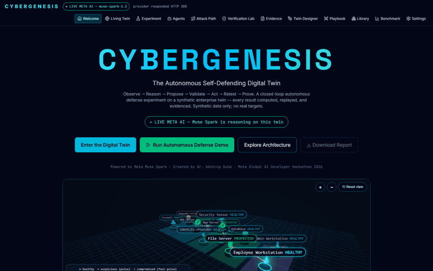
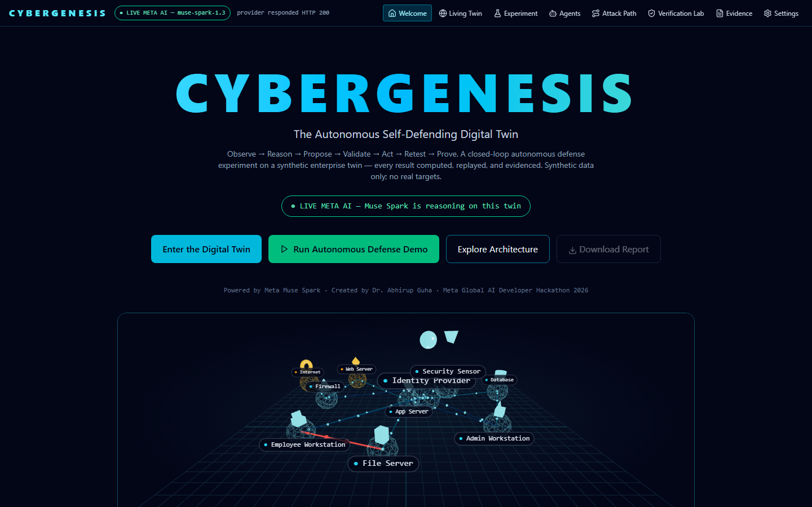
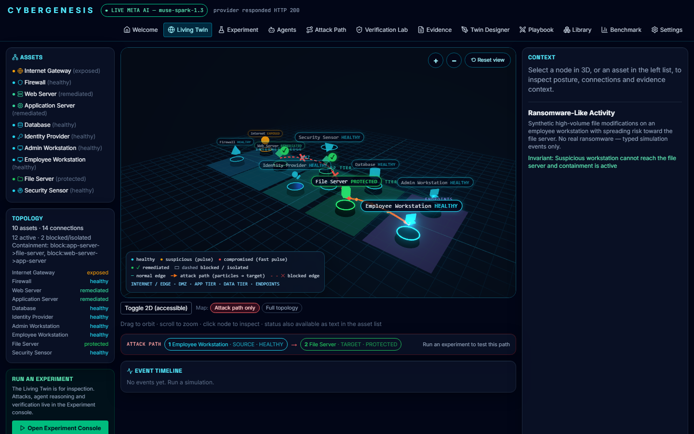
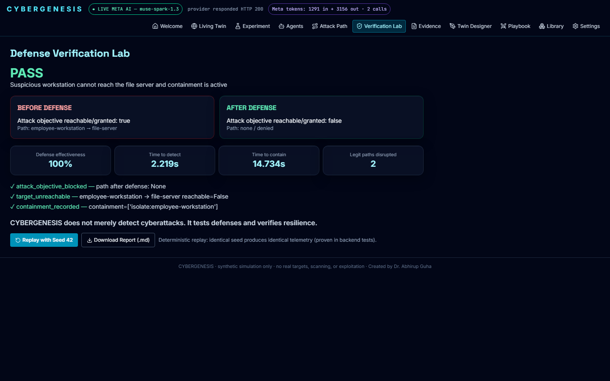

# CYBERGENESIS

### The Autonomous Self-Defending Digital Twin

[](https://github.com/fir3storm/cybergenesis/actions/workflows/ci.yml)

> **Built for the Meta Global AI Developer Hackathon 2026**
> Created by **Dr. Abhirup Guha** · Powered by **Meta Muse Spark**
>
> *CYBERGENESIS does not merely detect cyberattacks. It tests defenses — and proves resilience.*



---

## The problem: security teams drown in alerts, but starve for proof

Modern defenders face a structural problem, not a tooling problem:

- **Attacks move at machine speed; defense moves at ticket speed.** Ransomware and lateral movement unfold in minutes, while detection, triage, approval, and remediation still pass through dashboards, queues, and change windows measured in hours.
- **Alerts are abundant; evidence is scarce.** SOCs are flooded with detections, yet most tools stop at *"something looks wrong."* They rarely answer the questions that matter: *What exactly happens next? Will this fix actually stop it? What legitimate work will the fix break?*
- **You cannot rehearse on production.** Teams cannot safely test whether a segmentation rule, credential rotation, or isolation would stop a real attack path — so untested defenses fail for the first time during a real incident.
- **Automation is hard to trust.** Letting an AI change firewall rules or isolate machines feels reckless, so automation stalls at recommendations a human must still verify by hand. The result: skilled analysts burn out on repetitive triage while mean-time-to-contain stays stubbornly high.
- **Attackers adapt; static playbooks don't.** A defense that blocks one route teaches the adversary to find another. Fixed runbooks cannot keep up with an opponent who learns.

**CYBERGENESIS solves this by giving defenders a safe place to fight, learn, and prove.** On a synthetic digital twin, autonomous agents attack and defend continuously: the AI proposes, a deterministic policy engine disposes, an independent verifier replays the attack and produces *proof* — not claims — that the defense works, at what operational cost. Defenses are rehearsed, measured, and certified before they ever touch a real network, and both sides get smarter every match.

## What is CYBERGENESIS?

CYBERGENESIS is a closed-loop, autonomous cybersecurity digital twin. AI agents watch over a **synthetic** enterprise network. A controlled red team introduces incidents. Meta Muse Spark investigates the telemetry, works out a defense from the live network graph — no per-scenario instructions, it reasons it out — and proposes countermeasures. A deterministic policy engine (independent of the LLM) approves only allowlisted actions. The twin applies them. Then an independent Verification Scientist replays the identical attack to **prove, with computed before/after evidence, whether it now fails**.

Everything is synthetic. No real targets, no scanning, no exploitation, no credential harvesting. See the [threat model](docs/threat-model.md).

## Why Meta AI is essential

Muse Spark plays **both sides**:

- **Blue team** — investigates evidence-cited telemetry and proposes defenses from the live graph. Live-verified on every builtin scenario with an optimality gap of 0 against the NetworkX minimum cut.
- **Red team** — in the Arena and battle rounds, it chooses among policy-validated attack paths and adapts while the twin hardens itself.
- **Vision** — its multimodal capability turns a whiteboard photo into a working digital twin (Twin Designer).

With no API key, the app says so honestly and runs a clearly labelled deterministic simulation instead. Meta AI is the difference between a scripted demo and an adaptive adversary. Provider failure is always reported — fake success is treated as a test failure.





---

## The Arena — red vs blue, self-learning until someone wins

The newest battleground. Pick any twin and scenario, choose a strategy, and spectate:

- **Red wins** by reaching the protected target after a defense. **Blue wins** by leaving Red no validated path, or by surviving every round.
- Each round: Red picks a validated attack path → Blue picks a candidate defense through the same policy gate → the replay check decides the round.
- **The AI picks, the scores learn.** Muse Spark chooses only among validated moves (an invalid pick is rejected, never applied), and a deterministic score memory — persisted across matches — records what blocked and what reached, biasing both sides in the next match.
- Every match is stored, a league table tracks Red/Blue wins per scenario, and the winner receives a **signed winner-proof certificate**, verifiable offline.

Strategy modes: **AI + learning** · **Learning only** · **Deterministic**.

## Proof-carrying defense

When a run's verdict is **PASS**, CYBERGENESIS hands you a proof instead of asking for trust: a self-contained, HMAC-signed certificate (event hash chain, campaigns replayed, per-campaign unreachable-proof with the blocking rule for every frontier arc, embedded final twin). Anyone can verify it offline — no LLM, no database:

```powershell
python scripts/verify_cert.py certificate-<runId>.json
# VALID — or INVALID, with the exact reason
```

A FAIL run gets no proof button. There is nothing to certify.

## Counterfactual time machine

Finished a run and wondered *"what if Blue had chosen differently?"* Fork the run at its decision point with an alternative candidate. The fork replays through the same policy gate and verifier as a brand-new recorded run — **the original is never changed** — and the Compare view shows both timelines and both twins side by side, with metric deltas for disruption, risk, rounds, and verdict.

## Approve from your phone

Some defenses disrupt legitimate paths, so they wait for a human. The approval card shows a **QR code**: scan it on the same Wi-Fi and your phone gets the action list, the impact, and Approve/Reject buttons. The link carries a one-time token that dies with the approval — reused, expired, or already-decided tokens all return **403** — and the decision joins the same audit trail, recorded as *approved via mobile*.

---

## Benchmark

50 seeded attacker/defender pairs (`python scripts/benchmark.py`, details in [docs/benchmark.md](docs/benchmark.md) and the in-app Benchmark page):

| Defender | Verification PASS | Mean effectiveness | Mean optimality gap | Mean legit paths disrupted |
|---|---|---|---|---|
| none | 0/50 (0%) | 0.0% | — (no defense) | 0.00 |
| offline | 50/50 (100%) | 100.0% | 0.16 | 0.00 |
| simulate | 50/50 (100%) | 100.0% | 0.16 | 0.00 |

## The scenarios

1. **Ransomware-like activity** — synthetic file-modification burst → isolate the workstation → replay proves the file server unreachable.
2. **Compromised credential** — suspicious admin session → revoke session + rotate the synthetic credential → replayed access denied.
3. **Lateral movement** — graph attack path web → app → database → segmentation at the choke point → replay proves the database unreachable.
4. **Data exfiltration** — synthetic bulk staging database → app → web → internet → egress segmentation at the DMZ → replay proves the database cannot reach the internet.
5. **Red vs Blue Battle** — the adaptive adversary retries over multiple rounds while the twin hardens; the seed of the Arena.

## Design your own

- **Twin Designer** — build a custom topology from the component palette (drag assets, click two to connect, save, activate), or photograph a whiteboard and let Muse Spark vision generate the twin.
- **Attack Playbook** — compose a custom scenario from the allowlisted step/defense libraries and run it through the identical loop.
- **Component Library** — browse every asset type, attack step, and defense action the policy engine accepts (`GET /api/library`).

Extras: Demo Commentary narration, human-readable Markdown reports, a live Meta token meter, Replay-with-Seed-42 telemetry-identity proof, keyboard shortcuts (Space / R / 1–4), and a full 3D living twin with a 2D accessibility fallback.

---

## Quick start (local, no Docker required)

Backend (Python 3.12+):

```powershell
cd backend
pip install -e .   # or use an existing env with fastapi/uvicorn/sqlalchemy/networkx/httpx
python -m uvicorn app.main:app --port 8000
```

Frontend (Node 20+):

```powershell
cd frontend
npm install
npm run dev        # http://localhost:5173
```

Open <http://localhost:5173> → **Run Autonomous Defense Demo** — then visit the **Arena** and start a match.

### Meta AI (live mode)

Without a key, the app runs in clearly labelled **OFFLINE SIMULATION** mode (deterministic, evidence-derived — never presented as Meta inference). For live inference:

```powershell
$env:MODEL_API_KEY = "<your key>"   # backend env only, never committed or displayed
$env:META_MODEL = "muse-spark-1.3"
```

Restart the backend; the header badge switches to **LIVE META AI** and `/api/models/status` reports provider reachability.

### Docker

Docker was not available on the development machine, so the Compose stack is provided but locally unverified:

```bash
cp .env.example .env   # fill MODEL_API_KEY if desired
docker compose up --build
```

## Tests

```powershell
cd backend;  python -m pytest -q;  python -m ruff check app tests
cd frontend; npm test; npm run build; npm run test:e2e   # Playwright, requires servers running
```

**140 backend tests** cover every scenario end-to-end (verification PASS), policy rejection, determinism, failed-defense detection, the proof certificate (valid + tampered), counterfactual forks, one-time mobile-approval tokens, and the Arena (engine win rules, learning memory, AI chooser validation with mocked provider, match persistence, winner certificates). Frontend: Vitest + Playwright end-to-end (demo → proof download, fork comparison, phone approval, Arena match). Test runs force `OFFLINE_MODE=true` for hermetic results; live Meta was verified separately on 2026-10-27/28 with real Muse Spark decisions (see [docs/evaluation.md](docs/evaluation.md)).

## Documentation

[Architecture](docs/architecture.md) · [Meta integration](docs/meta-integration.md) · [Evaluation](docs/evaluation.md) · [Demo script](docs/demo-script.md) · [Threat model](docs/threat-model.md) · [Hackathon submission](HACKATHON_SUBMISSION.md)

---

*Built with Meta Muse Spark for the Meta Global AI Developer Hackathon 2026. All data is synthetic; the twin defends only itself.*
