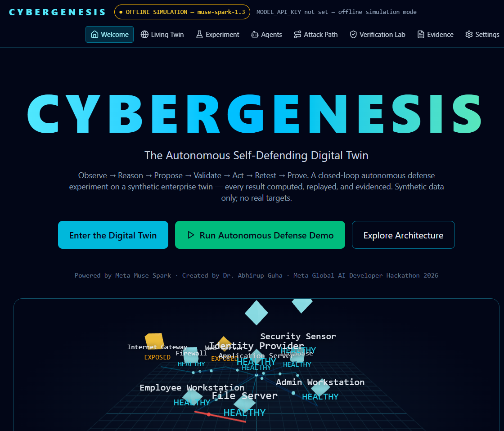
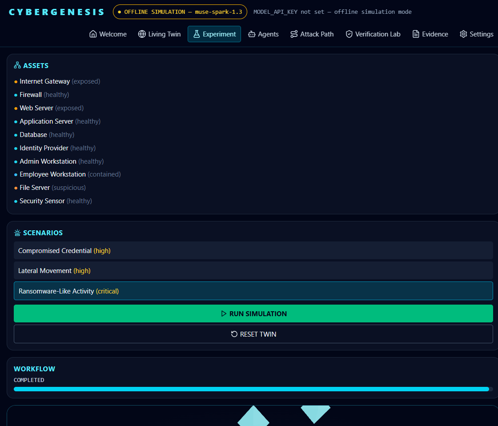

# CYBERGENESIS — The Autonomous Self-Defending Digital Twin

**Created by Dr. Abhirup Guha · Meta Global AI Developer Hackathon 2026 · Powered by Meta Muse Spark**

CYBERGENESIS does not merely detect cyberattacks. It tests defenses and verifies resilience.

A closed-loop autonomous cybersecurity digital twin: AI agents observe a synthetic enterprise, a controlled adversary introduces incidents, Meta Muse Spark investigates and proposes defenses, a deterministic policy engine approves only allowlisted actions, the twin applies them, and an independent Verification Scientist replays the identical attack to prove — with computed before/after evidence — whether it now fails.




## Quick start (local, no Docker required)

Backend (Python 3.12+):
```powershell
cd backend
pip install -e .   # or use an existing env with fastapi/uvicorn/sqlalchemy/networkx/httpx
python -m uvicorn app.main:app --port 8000
```

Frontend (Node 20+):
```powershell
cd frontend
npm install
npm run dev        # http://localhost:5173
```

Open http://localhost:5173 → **Run Autonomous Defense Demo**.

## Meta AI (live mode)

Without a key the app runs in clearly-labelled **OFFLINE SIMULATION** mode (deterministic, evidence-derived — never presented as Meta inference). For live inference:

```powershell
$env:MODEL_API_KEY = "<your key>"   # backend env only, never committed or displayed
$env:META_MODEL = "muse-spark-1.3"
```
Restart the backend; the header badge switches to **LIVE META AI** and `/api/models/status` reports provider reachability.

## Docker

Docker was not available on the development machine, so the Compose stack is provided but locally unverified:
```bash
cp .env.example .env   # fill MODEL_API_KEY if desired
docker compose up --build
```

## Tests

```powershell
cd backend;  python -m pytest -q;  python -m ruff check app tests
cd frontend; npm test; npm run build
```
12 backend tests cover all 3 scenarios end-to-end (verification PASS), policy rejection, determinism, failed-defense detection, and honest provider failure. The live Meta integration test is opt-in only (`RUN_META_INTEGRATION=1` + key) — not part of the default suite.

## The three scenarios
1. **Ransomware-like activity** — synthetic file-modification burst → isolate workstation → replay proves file server unreachable.
2. **Compromised credential** — suspicious admin session → revoke session + rotate synthetic credential → replayed access denied.
3. **Lateral movement** — graph attack path web→app→database → segmentation at the choke point → replay proves database unreachable.

All data is synthetic. No real targets, scanning, exploitation, or credential harvesting — see `docs/threat-model.md`.

## Docs
`docs/architecture.md` · `docs/meta-integration.md` · `docs/evaluation.md` · `docs/demo-script.md` · `docs/threat-model.md` · `HACKATHON_SUBMISSION.md`
